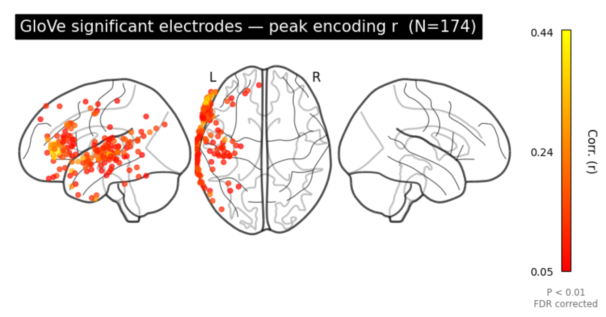
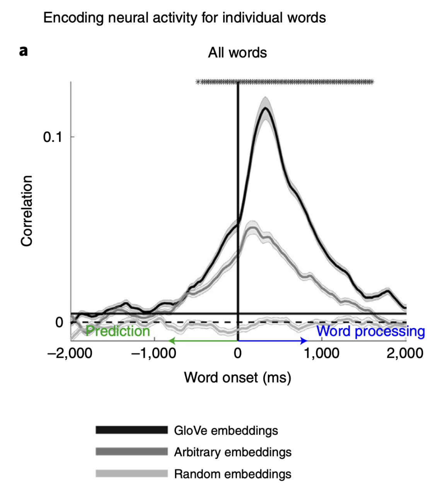
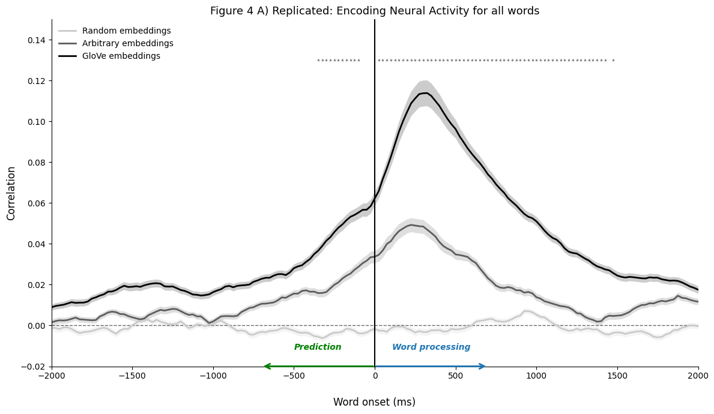
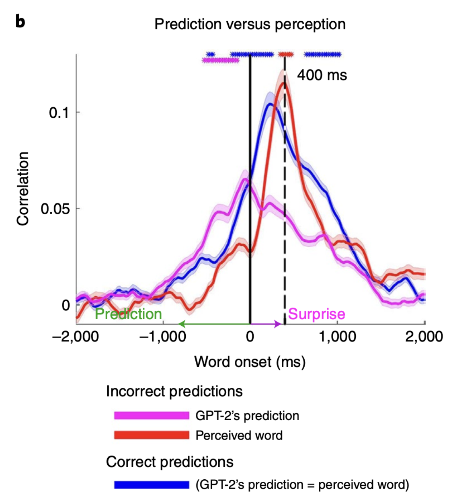
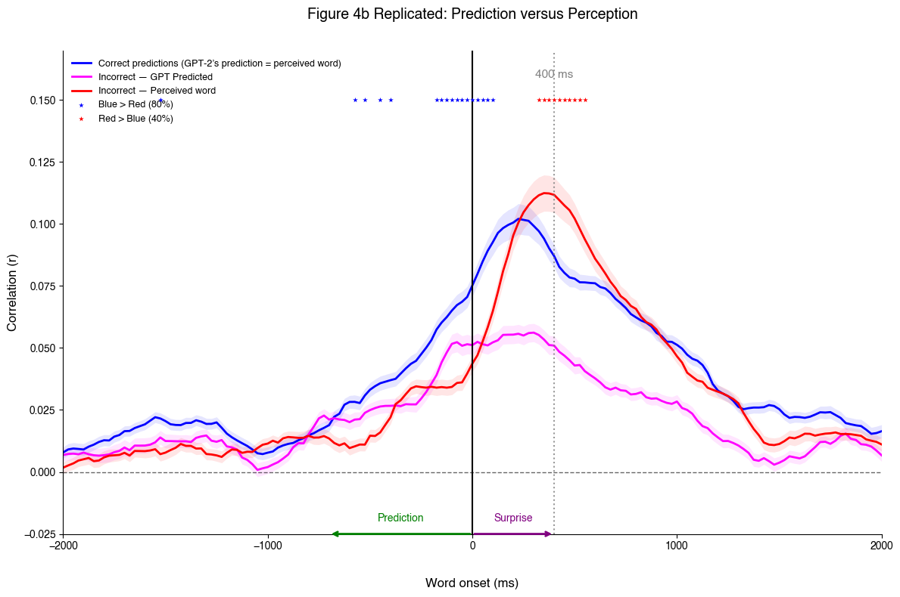
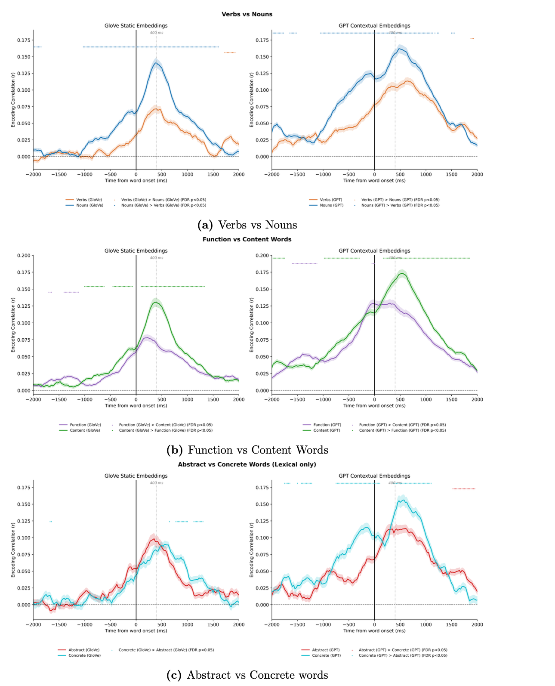

# Shared Computational Principles in Brains and Language Models: Replication & Extension

A replication of key results from Goldstein et al. (2022), *"Shared computational principles for language processing in humans and deep language models"* (Nature Neuroscience), using the public **Podcast ECoG dataset**, followed by a novel analysis asking whether brain–model alignment depends on **word category** and **semantic distance**.


## Summary

The original paper argues that the human brain, like an autoregressive language model, continuously predicts upcoming words before they are heard, and registers "surprise" after onset when the prediction is wrong. This project:

1. **Replicates Figures 4–6** of the paper using linear encoding models (ridge regression) that predict intracranial (ECoG) activity from word embeddings (GloVe and GPT-2 XL).
2. **Tests two new hypotheses** motivated by predictive coding theory:
   - **Word category alignment.** Brain–model encoding performance is not uniform across linguistic categories (nouns vs verbs, content vs function words, concrete vs abstract words).
   - **Graded error potentials.** For words GPT-2 predicted incorrectly, the post-onset neural surprise signal scales with how semantically far the prediction was from the actual word.

Both hypotheses were supported. The full write-up is in [`AI_NEURO_REPORT.pdf`](AI_NEURO_REPORT.pdf).


## Novel hypotheses:
The Impact of Semantic Similarity and Word Category on Neural Encoding and Predictive Error.

The general consensus is that the brain does not represent all words in the same way. The brain uses distributed semantic representations, which change depending on the context but also depending on what the specifc word is. Base on this knowledge, the notebook (['Notebook Part 2 Novel Hypotheses'](06_Part2_Novel_Hypotheses.ipynb) ) tests how the encoding models are influenced by the words used, specifically two sub-questions/hypothesis are tested :


### Hypothesis 1 — How the Word Category Modulates Encoding (extension of Fig 6B )
Original paper averaged glove and gpt embeddings across all words, I hypothesise the encoding results (correlation) can differ by **lexical category**:
- **Lexical/content words** (nouns, verbs, adjectives, adverbs) vs **functional words** (determiners, prepositions, conjunctions)
- **Nouns** (people, places or things) vs **verbs** ( sleep, run, dance, sing); most nouns and verbs are lexical
- **Concrete** (things you can perceive or sense e.g. apple, chair, rain) vs **abstract** (things that are abstract/can’t directly sense like truth,  freedom, justice) words


### Hypothesis 2 — How semantic distance between Prediction and true word for the incorrect words, modulates prediction-error signals (extension of Fig 4B )
The original paper grouped together all incorrect predictions, in this notebook, I separate the incorrect words into 3 groups based on the distance:
- **Group 1 (nearby)** : incorrectly predicted word is close to true word
- **Group 2(further-away)**: incorrectly predicted word is further award from true word
- **Group 3(Far away)**: incorrectly predicted word is far from true word

Distance is measured by GloVe cosine distance between the *predicted* word and the *actually perceived* words. Can't use GPT contextual embedding since only have words that are actually present in the sequence/ do not have incorrect prediction's embedding. 

Electrodes used: same as before 174 (from the significant electrodes analysis)


## Methods at a glance

- **Data:** Podcast ECoG dataset (Zada et al., 2025): intracranial recordings from 9 epilepsy patients listening to a 30-minute podcast. Only left-hemisphere electrodes were analysed; subject 01 had right-hemisphere coverage only and was excluded.
- **Features:** 50-d GloVe (`glove.6B.50d`) static embeddings; GPT-2 XL final-layer (layer 48) contextual embeddings reduced to 50-d with PCA; GPT-2 next-word rank, probability, entropy and cross-entropy.
- **Preprocessing:** Epochs from −2000 to +2000 ms around each word onset, averaged in 200 ms windows at 25 ms steps (161 lags).
- **Encoding model:** Ridge regression (`himalaya` `RidgeCV`, α ∈ 10¹…10¹⁰, nested 5-fold CV) with 10-fold outer cross-validation; performance measured as the correlation between predicted and actual neural signal.
- **Electrode selection:** The paper's randomization procedure was too computationally expensive, so electrodes were selected with a one-sample t-test on cross-validated encoding correlations, FDR-corrected at q < 0.01. This gave **174 electrodes** for GloVe and **206** for GPT-2.
- **Statistics:** Time-point differences tested with sign-flip permutation tests, FDR correction, and a majority-electrode (>50%) agreement criterion.
- **Word categories:** Part-of-speech and function/content tags from the dataset's syntactic annotations; concreteness from Brysbaert et al. (2014), with concrete ≥ 4.0 and abstract ≤ 2.5.

## Repository structure

### Project Structure

📄 **`AI_NEURO_REPORT.pdf`** — Complete written report detailing the study, methodology, and findings.

* 📁 **`notebooks/`** — Analysis and figure-generation notebooks
  * 📓 `01_Electrode_Selection_and_Fig4A.ipynb` — GloVe encoding & electrode selection
  * 📓 `02_Fig4B_and_Fig5A.ipynb` — Correct vs. incorrect prediction analyses
  * 📓 `03_Fig5B_Uncertainty_vs_Surprise.ipynb` — Pearson & partial correlations
  * 📓 `04_Fig6A_GPT2_Brain_Plots.ipynb` — GPT-2 electrode selection & brain visualization
  * 📓 `05_Fig6B_Embedding_Comparisons.ipynb` — Contextual vs. static vs. control embeddings
  * 📓 `06_Part2_Novel_Hypotheses.ipynb` — Semantic distance & word-category analyses
* 📁 **`data/`** — Source data and ratings
  * 📊 `significant_electrodes_glove.csv` — 174 selected electrodes (subject, channel, MNI coords)
  * 📊 `Concreteness_ratings_Brysbaert_et_al.xlsx` — Lexical concreteness baselines
* 📁 **`figures/`** — Exported result figures and plots
* ⚙️ **`environment.yml`** — Conda environment specifications and dependencies

Run the notebooks in the order listed. `01_Electrode_Selection_and_Fig4A.ipynb` produces `significant_electrodes_glove.csv`, which the later notebooks reuse; a copy is included so they can be run independently (inside the folder data).

## Setup

### 1. Environment

```bash
conda env create -f environment.yml
conda activate mne
pip install pingouin          # used for partial correlations in figure_5b__.ipynb
python -m nltk.downloader stopwords
```

A CUDA-capable GPU is optional; `himalaya` can use a PyTorch backend to speed up ridge regression.

### 2. Data (not included in this repository because can be found online)

- **Podcast ECoG dataset (BIDS):** download from OpenNeuro (dataset `ds005574`). The notebooks expect the `derivatives/ecogprep` folder and the `stimuli/` folder (including `stimuli/gpt2-xl/` and `stimuli/syntactic/`).
- **GloVe:** download `glove.6B.zip` from the [Stanford GloVe page](https://nlp.stanford.edu/projects/glove/) and place `glove.6B.50d.txt` in the project root.

### 3. Paths

Set `bids_root` at the top of each notebook to the location of your downloaded dataset.

## Sample of Results & Figures

To demonstrate the replication and novel extensions, here is a curated selection of core visualizations generated from the analysis notebooks (full figures are saved in the [`figures/`](figures/) directory):

### 1. Replication: Brain-Model Alignment
* **Electrode Selection:** Significant intracranial electrodes identified via ridge regression and FDR correction.



* **Figure 4A: Modeling of neural signals before and after word onset for predictable** 
  
| **Original Paper (Goldstein et al., 2022 — Fig 4A)** | **Replication (GloVe 50-d Encoding)** |
| :---: | :---: |
|  |  |
| *Original study electrode mapping* | *Replication electrode mapping (174 electrodes)* |

* **Figure 4B, Prediction Error & Surprise:** Neural responses split by correct vs. incorrect word predictions.

| **Original Paper (Fig 4B)** | **Replication (Fig 4B & 5A)** |
| :---: | :---: |
|  |  |
| *Original surprise responses* | *Replicated post-onset neural surprise* |

---


### 2. Novel Hypothesis: Word Category Modulation
An example figure from the word category hypothesis; seeing if there are differences between Nouns vs. Verbs, Content vs. Function, and Abstract vs Concrete Words.
 


## Limitations

- Electrode selection used a t-test with FDR correction instead of the paper's randomization procedure, which likely admits a noisier set of electrodes and contributes to the magnitude differences above.
- The semantic-distance analysis uses GloVe cosine distance as a proxy for "how wrong" a prediction was; other measures (e.g. contextual similarity) might give different groupings.
- The word-category comparisons have unequal and sometimes small sample sizes per category, and categories are correlated with other properties (word frequency, length, predictability) that were not controlled for.

## References

1. Goldstein, A. et al. (2022). Shared computational principles for language processing in humans and deep language models. *Nature Neuroscience*, 25(3), 369–380. https://doi.org/10.1038/s41593-022-01026-4
2. Zada, Z. et al. (2025). The "Podcast" ECoG dataset for modeling neural activity during natural language comprehension. *Scientific Data*, 12. https://www.nature.com/articles/s41597-025-05462-2
3. Brysbaert, M., Warriner, A. B., & Kuperman, V. (2014). Concreteness ratings for 40 thousand generally known English word lemmas. *Behavior Research Methods*, 46(3), 904–911. https://doi.org/10.3758/s13428-013-0403-5
4. Pennington, J., Socher, R., & Manning, C. D. (2014). GloVe: Global Vectors for Word Representation. *EMNLP*.

The full reference list, including the predictive-coding literature motivating the novel hypotheses, is in the report.

## Acknowledgements

Completed as coursework for an *AI and Neuroscience* module. Thanks to the authors of the Podcast ECoG dataset for making the data and tutorials openly available.
